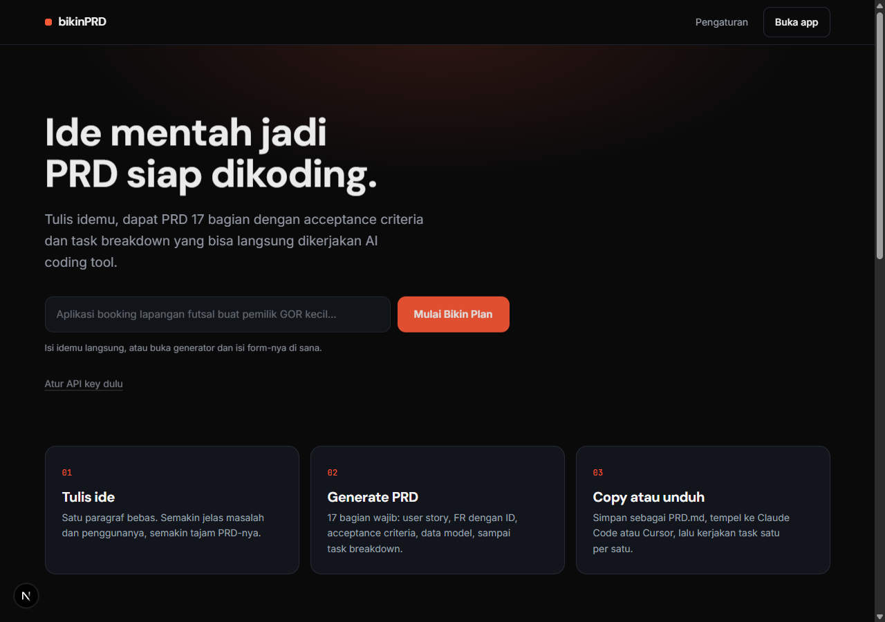
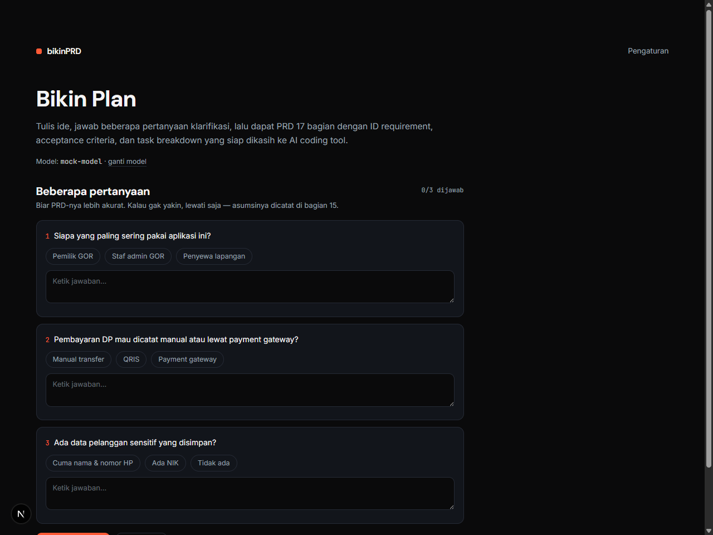
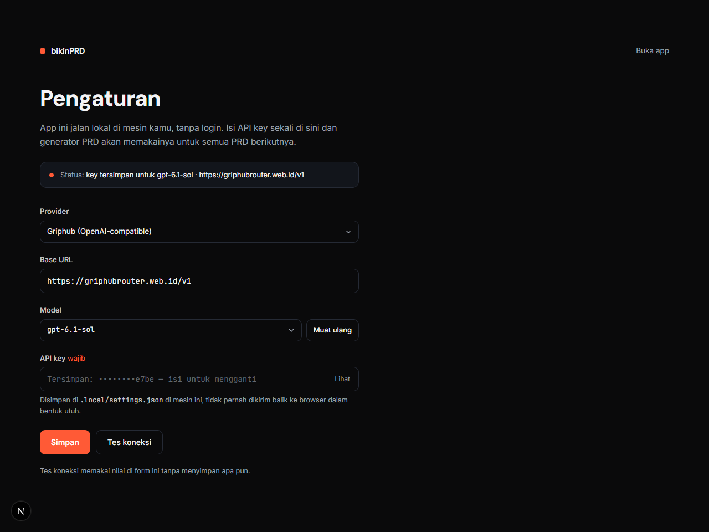

# bikinPRD

**Ubah ide mentah jadi PRD siap dikoding.** Tulis satu paragraf, jawab beberapa
pertanyaan, lalu dapat dokumen 17 bagian dengan ID requirement, acceptance criteria,
dan task breakdown yang bisa langsung dikerjakan Claude Code, Cursor, atau Windsurf.

Jalan **lokal di mesin kamu** — tanpa login, tanpa server, tanpa langganan.
Kamu pakai API key provider sendiri (BYOK).

[](LICENSE)
[](https://nextjs.org)
[](https://nodejs.org)
[](#apa-yang-dihasilkan)



## Daftar isi

- [Kenapa](#kenapa)
- [Cara kerjanya](#cara-kerjanya)
- [Apa yang dihasilkan](#apa-yang-dihasilkan)
- [Untuk agent, bukan cuma buat dibaca](#untuk-agent-bukan-cuma-buat-dibaca)
- [Mulai](#mulai)
- [Provider & model](#provider--model)
- [Privasi & keamanan](#privasi--keamanan)
- [Batasan & roadmap](#batasan--roadmap)
- [Struktur](#struktur)
- [Kontribusi](#kontribusi)
- [Lisensi](#lisensi)

## Kenapa

AI coding agent menghasilkan kode yang buruk kalau instruksinya ambigu. Kebanyakan
orang langsung prompt "bikinin aplikasi X" tanpa spesifikasi, lalu heran kenapa
hasilnya ngawur dan scope-nya melebar.

bikinPRD memaksa idemu keluar sebagai dokumen yang bisa dieksekusi: setiap
requirement punya ID, acceptance criteria yang bisa diuji, dan task atomik dengan
definition of done.

## Cara kerjanya

Tiga langkah di `/app/new`, mengikuti alur "sebelum jadi PRD":

1. **Ide + preferensi teknologi.** Tulis idemu (minimal 20 karakter), lalu pilih
   *biarkan AI merekomendasikan stack* atau tentukan sendiri frontend/backend/
   database/hosting lewat dropdown (ada opsi **Tulis sendiri…**).
2. **Pertanyaan klarifikasi.** Model membuat 3–6 pertanyaan yang benar-benar kritis
   (pengguna utama, alur inti, monetisasi, data sensitif, skala). Tiap pertanyaan
   punya pilihan cepat + isian bebas. Bisa dilewati — asumsinya dicatat di bagian 15.
3. **PRD streaming.** Dokumen ditulis token per token di panel `PRD.md`, lalu bisa
   di-**Copy** atau **Unduh** sebagai `PRD.md`.

| Pertanyaan klarifikasi | Pengaturan provider |
| --- | --- |
|  |  |

Di balik layar, jawabanmu digabung jadi satu `<brief>` JSON (ide + tech stack +
jawaban klarifikasi) yang dikirim bersama system prompt berisi aturan penulisan PRD.

## Apa yang dihasilkan

PRD 17 bagian, urut dan wajib:

| # | Bagian | # | Bagian |
| --- | --- | --- | --- |
| 1 | Ringkasan Produk | 10 | Data Model |
| 2 | Tujuan & Metrik | 11 | API Contract |
| 3 | Persona & Aktor | 12 | Arsitektur & Tech Stack |
| 4 | Ruang Lingkup | 13 | Keamanan & Privasi |
| 5 | User Stories (`US-001`) | 14 | Edge Cases & Error Handling |
| 6 | Kebutuhan Fungsional (`FR-001`) | 15 | Asumsi & Pertanyaan Terbuka |
| 7 | Acceptance Criteria (Given/When/Then) | 16 | Task Breakdown (`T-001`) |
| 8 | Kebutuhan Non-Fungsional (`NFR-001`) | 17 | Milestone |
| 9 | Alur Pengguna | | |

Aturan yang dipaksa di prompt (bukan sekadar saran):

- Setiap FR punya minimal satu acceptance criteria, termasuk **satu skenario gagal**.
- Traceability: FR → US, task → FR; FR prioritas *Must* wajib punya task.
- Dilarang kata ambigu tanpa angka: "cepat", "mudah", "user-friendly", "optimal".
- Dilarang mengarang angka bisnis atau statistik pasar — kalau tidak ada, tulis asumsi.
- Task harus atomik: bisa selesai dalam satu sesi agent, ≤ 5 file, ada definition of done.

## Untuk agent, bukan cuma buat dibaca

bikinPRD sengaja berhenti di **lapisan spec**. Yang mengeksekusi tetap agent pilihanmu
(Claude Code, Cursor, Windsurf, Codex) — jadi tidak ada vendor lock dan tidak ada
runtime agent yang harus dipercaya.

Sekarang: hasil generate bisa langsung di-**Copy** atau **Unduh** sebagai `PRD.md`,
lalu ditempel ke agent sebagai konteks. Bagian 16 (Task Breakdown) sudah ditulis
sebagai task atomik — satu task = satu sesi agent, ≤ 5 file, ada definition of done —
supaya bisa dikerjakan berurutan tanpa agent mengarang urutan sendiri.

Rencana berikutnya supaya agent tidak perlu "disuruh" manual:

| Artefak | Isi | Status |
| --- | --- | --- |
| `PRD.md` | dokumen lengkap 17 bagian | ✅ ada |
| `TASKS.md` | checklist task urut dependensi, siap dicentang | ⏳ rencana |
| `tasks.json` | versi mesin: `id`, `files`, `acceptance[]`, `depends_on[]`, `status` | ⏳ rencana |
| `AGENTS.md` / `CLAUDE.md` | kontrak project: stack, konvensi, cara run/test, aturan "kerjakan satu task lalu verifikasi" | ⏳ rencana |
| MCP server | agent memanggil `generate_prd` / `get_tasks` langsung dari editor | ⏳ rencana |

Yang **tidak** akan dikerjakan: menjalankan task-nya sendiri. bikinPRD bukan runner
agent — kalau mulai mengeksekusi kode, dia bersaing langsung dengan Claude Code dan
kehilangan alasan untuk ada.

## Mulai

**Butuh:** Node.js 20+, pnpm, dan API key dari salah satu [provider](#provider--model).

```bash
git clone https://github.com/<username>/bikinPRD.git
cd bikinPRD
pnpm install
pnpm dev
```

Buka <http://localhost:3000>:

1. **Pengaturan** → pilih provider → tempel API key → **Tes koneksi** → **Simpan**.
2. **Buka app** → tulis ide → **Lanjut: pertanyaan klarifikasi** (atau lewati).
3. **Generate PRD** → **Copy** / **Unduh PRD.md**.

Perintah lain: `pnpm build` + `pnpm start` (produksi), `pnpm lint`.

## Provider & model

| Provider | Base URL | Contoh model | Key diambil dari |
| --- | --- | --- | --- |
| Griphub (OpenAI-compatible) | `https://griphubrouter.web.id/v1` | `gpt-4o-mini` | dashboard Griphub |
| OpenAI | `https://api.openai.com/v1` | `gpt-4o-mini` | platform.openai.com/api-keys |
| OpenRouter | `https://openrouter.ai/api/v1` | `openai/gpt-4o-mini` | openrouter.ai/keys |
| Anthropic | `https://api.anthropic.com/v1` | `claude-sonnet-4-5` | console.anthropic.com |
| Custom | endpoint OpenAI-compatible apa pun | sesuai provider | — |

Tombol **Muat daftar model** menarik daftar model asli dari provider, jadi kamu
tinggal pilih dari dropdown (masih bisa tulis manual kalau modelnya tidak terdaftar).
**Tes koneksi** menembak provider beneran, jadi ketahuan langsung kalau key salah.

Kualitas PRD ikut model. Model kelas kecil cenderung menghasilkan dokumen pendek dan
bolong; model kelas atas menghasilkan task breakdown yang jauh lebih rapi.

## Privasi & keamanan

- API key disimpan **di mesin kamu**: `.local/settings.json` (folder `700`, file
  `600`, dan sudah masuk `.gitignore`). Hapus file itu kalau mau mencabut key.
- Key **tidak pernah** dikirim balik ke browser dalam bentuk utuh — `GET /api/settings`
  hanya mengembalikan 4 karakter terakhir.
- Request generasi berjalan dari server lokal kamu **langsung ke provider** yang kamu
  pilih. Tidak ada backend pihak ketiga, tidak ada telemetry.
- Isi ide dibungkus sebagai data di dalam `<brief>`, bukan instruksi, untuk mengurangi
  risiko prompt injection dari isi ide.
- Tidak ada akun, database, atau sinkronisasi. Satu mesin, satu pengguna.

## Batasan & roadmap

Belum ada (kontribusi terbuka untuk ini):

- [ ] Skor validator kualitas otomatis + tombol "Perbaiki"
- [ ] Regenerate per bagian dan riwayat versi
- [ ] Ekspor `TASKS.md`, `tasks.json`, `AGENTS.md` / `CLAUDE.md`, dan ZIP
- [ ] MCP server: agent memanggil generator langsung dari editor
- [ ] Simpan riwayat PRD ke disk
- [ ] Diagram Mermaid (ERD, sequence, flowchart)
- [ ] Ekspor PDF / DOCX

## Struktur

```
src/
  app/
    (marketing)/          landing
    api/clarify/          POST — 3–6 pertanyaan klarifikasi (JSON)
    api/generate/         POST — stream PRD (text/plain)
    api/settings/         GET/PUT key lokal, POST tes koneksi, POST daftar model
    app/new/              generator (alur 3 langkah)
    settings/             form API key + pemilih model
  components/
    marketing/            hero, cara kerja, contoh output, CTA, footer
    app/                  form generator (ide → klarifikasi → hasil)
    settings/             form pengaturan
    ui/Select.tsx         dropdown custom (native select, panah sendiri)
  lib/
    clarify.ts            prompt pertanyaan + parser JSON provider
    generate.ts           prompt 17 bagian + parser SSE provider
    settings.ts           baca/tulis .local/settings.json, tes provider, daftar model
    site.ts               route & label
    analytics.ts          event tracking lokal (dataLayer)
```

Streaming diparse langsung dari provider: `choices[0].delta.content` untuk
OpenAI-compatible, `content_block_delta` untuk Anthropic.

## Kontribusi

Issue dan pull request terbuka. Untuk perubahan besar, buka issue dulu biar arahnya
jelas. Sebelum PR: `pnpm lint` dan `pnpm build` harus hijau.

## Lisensi

[MIT](LICENSE) — pakai, ubah, jual, atau bikin turunannya, bebas.

## Catatan

bikinPRD tidak berafiliasi dengan OpenAI, Anthropic, Moonshot, DeepSeek, Cursor,
Claude Code, atau Windsurf. Nama model dan tool disebut sebagai fakta, bukan klaim
kemitraan. PRD dihasilkan model bahasa — baca ulang sebelum dieksekusi.
